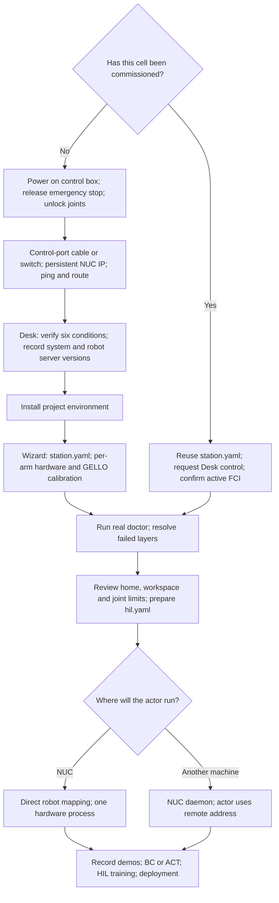

# Getting started on hardware

Start with the [overview and safety notes](tutorial/00-overview.md). The default
is a NUC running the recorder or HIL actor directly through franky, with a
`real_robot.robot` configuration. A separate GPU learner does not require a
robot daemon. The target operator workflow is cartesian GELLO at 50 Hz; pending
implementation and later-page migration limits are listed in the overview.

| Stage | Instructions |
|---|---|
| New cell: power, network, Desk | [01 steps 1–3](tutorial/01-install.md#1-power-on-the-cell) |
| Install and real handshake | [01 steps 4–5](tutorial/01-install.md#4-install-the-project-environment) |
| Serial, keyboard and USB fixes | [01 step 6](tutorial/01-install.md#6-fix-serial-and-keyboard-checks) |
| Existing cell: three checks | [A robot someone else has already commissioned](tutorial/01-install.md#a-robot-someone-else-has-already-commissioned) |
| Station, calibration and limits | [02 Station](tutorial/02-station.md) |
| Two arms: independent Desk and FCI | [02 Multiple arms](tutorial/02-station.md#multiple-arms) |
| Direct versus remote actor | [03 Process layout and optional daemon](tutorial/03-daemon.md) |
| Target operator keys and migration status | [00 Operator keys](tutorial/00-overview.md#operator-keys) |
| Record and learn | [04 Demos](tutorial/04-record-demos.md), [05 BC/ACT](tutorial/05-base-policy.md), [06 Interventions](tutorial/06-intervening.md), [07 HIL](tutorial/07-hil-training.md) |
| Run a trained policy | [08 Deploy](tutorial/08-deploy.md) |

Each command block in the commissioning pages states the machine, repository
working directory and project environment. A mock doctor pass checks software/configuration;
only the real doctor handshake confirms FCI access. Check the overview's delivery
dependencies before following the target installer and key workflow.
