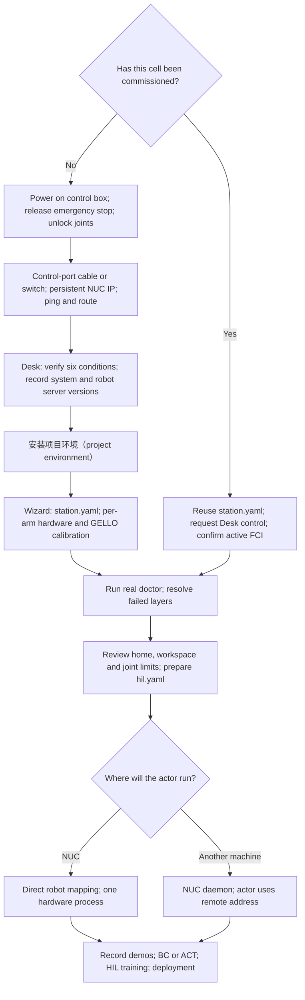

<!-- English source: docs/getting-started-hardware.md -->

# 真机入门

[中文入口](../README.zh-CN.md) · [English](../getting-started-hardware.md)

先读[总览与安全](tutorial/00-overview.md)。默认 NUC 用 `real_robot.robot` 配置通过 franky 直接运行 recorder 或 HIL actor；独立 GPU learner 不需要机器人守护进程。目标操作路线为 50 Hz 笛卡尔 GELLO，待实现和后续页面迁移限制见总览。

| 阶段 | 指引 |
|---|---|
| 新工位：上电、网络、Desk | [01 步骤 1–3](tutorial/01-install.md#1-power-on-the-cell) |
| 安装与真实握手 | [01 步骤 4–5](tutorial/01-install.md#4-安装项目环境) |
| 串口、键盘、USB 修复 | [01 步骤 6](tutorial/01-install.md#6-fix-serial-and-keyboard-checks) |
| 已配置工位三项检查 | [别人已配置过的机器人](tutorial/01-install.md#a-robot-someone-else-has-already-commissioned) |
| station、标定与限位 | [02 工作站](tutorial/02-station.md) |
| 双臂独立 Desk / FCI | [02 多臂](tutorial/02-station.md#multiple-arms) |
| 本地与远程 actor | [03 进程布局](tutorial/03-daemon.md) |
| 目标操作按键与迁移状态 | [00 按键](tutorial/00-overview.md#operator-keys) |
| 录制与学习 | [04 示范](tutorial/04-record-demos.md)、[05 BC/ACT](tutorial/05-base-policy.md)、[06 介入](tutorial/06-intervening.md)、[07 HIL](tutorial/07-hil-training.md) |
| 运行已训练策略 | [08 部署](tutorial/08-deploy.md) |

配置页每个命令块注明机器、仓库工作目录和项目环境。mock doctor 只查软件/配置，真实握手才确认 FCI。使用目标安装器和按键路线前，先看总览的交付依赖。
